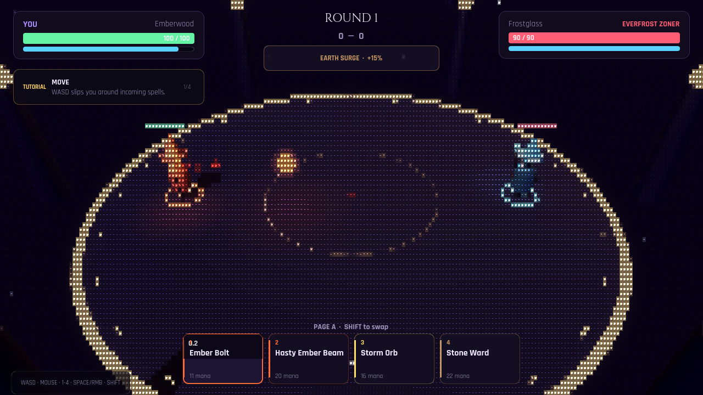

# ASCII Post-Process — Experiment

**Status: keep as an optional toggle. Default OFF.**

## Use

| Input | Action |
|---|---|
| `F9` / `F10` | Toggle the ASCII post-process |
| `--ascii` | Start with it enabled (for the existing `--shot-*` modes) |

Normal play is unchanged. The effect is a single full-screen canvas pass that
sits at layer 3, below the HUD (layer 5), so the HUD and menus remain readable.

## What it does

- Down-samples the 3D view into a 6×9 px character cell grid.
- Maps luminance + color saturation to a 10-step ramp: ` .:-=+*#%@`.
- Samples a runtime-free glyph atlas (`assets/ascii_glyphs.png`, Rajdhani Bold).
- Color mode keeps the scene's palette (orange player, blue rival, elemental
  rim); monochrome is available via the shader's `color_mode` uniform.

## Verification

- `assets/ascii_glyphs.png` is lossless-imported for clean alpha.
- Desktop screenshot: this file (`docs/ascii_experiment.png`), taken with
  `--ascii --shot-duel`.
- The same command without `--ascii` is visually unchanged.
- Headless tests: `--test`, `--flow`, `--lifetime`, `--audio-selftest` pass.
- Web export compiles the shader under GL Compatibility.

## Performance

One screen-texture sample + one glyph sample per pixel; no extra SubViewport or
render-target copy. I did not run a frame-time benchmark on this heavily loaded
machine — verify on the target browser before treating it as free.

## Recommendation

Keep it behind `F10`; do not enable by default. It is a fun optional presentation
mode and costs little, but the standard rendering is clearer for first-time
players and for reading projectiles. If a future mode wants a diegetic "scrying
terminal" look, this is the base.
